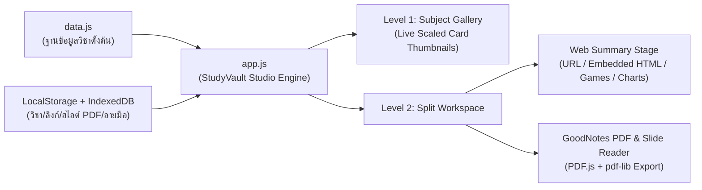

<div align="center">

# 📚 StudyVault — Studio Hub &amp; Side-by-Side Slide Reader

**คลังศูนย์รวมเว็บสรุปบทเรียนและสไลด์อ่านเทียบข้างๆ กัน พร้อมระบบเขียนโน้ตบน PDF สไตล์ GoodNotes**  
*ออกแบบในสไตล์ **OpenHiggsfield Studio** (`#0a0a0b` Near-Black Canvas + `#d1fe17` Acid Lime Accent)*

[](https://phumshoprt.github.io/STUDY_WEB/)
[](https://mozilla.github.io/pdf.js/)
[](#-สถาปัตยกรรมระบบ)

[**🚀 เปิดใช้งานเว็บจริง (GitHub Pages)**](https://phumshoprt.github.io/STUDY_WEB/) · [**📖 คู่มือใช้งาน**](#-วิธีใช้งานอย่างรวดเร็ว) · [**🧩 วิธีเพิ่มวิชา/ลิงก์**](#-การเพิ่มรายวิชาและสื่อการเรียน)

</div>

---

## ✨ ฟีเจอร์หลัก (Core Features)

### 1. 🖥️ แยกรายวิชา + พรีวิวหน้าเว็บจริงบนการ์ด (2-Level Studio Hub)
- **หน้าคลังวิชา (Level 1):** การ์ดแต่ละวิชาแสดง **Mini-Browser Live Preview** ย่อสเกลอัตโนมัติตามขนาดจอ (`ResizeObserver`) พร้อมแถบหมวดหมู่ Sliding Scope Tabs และค้นหาด่วนด้วยคีย์ลัด `/`
- **หน้าห้องเรียนรายวิชา (Level 2):** กดเข้าวิชาเพื่อดูรายการลิงก์สรุปทั้งหมดและสไลด์เรียนของวิชานั้น รองรับการเพิ่ม/แก้ไข/ลบ และ **Undo Bar 6 วินาที**

### 2. ◫ โหมดอ่านเว็บสรุปเทียบสไลด์ข้างๆ กัน (Side-by-Side Split View)
- แบ่งหน้าจอ 2 ฝั่ง (เว็บสรุป ↔ สไลด์เรียน) พร้อม **เส้นแบ่งตรงกลางที่ลากปรับสัดส่วนซ้าย–ขวาได้ (25%–75%)**
- กดปุ่ม **`⇄ สลับฝั่ง`** เพื่อสลับให้สไลด์อยู่ซ้ายหรือขวาตามความถนัด พร้อมจำการตั้งค่าไว้ให้อัตโนมัติ
- รองรับสไลด์ 3 รูปแบบ: **ไฟล์ PDF**, **ชุดรูปภาพสไลด์หลายแผ่น**, และ **ลิงก์สไลด์ (Google Slides Auto-Embed / HTML)**

### 3. ✏️ จดโน้ตบน PDF สไตล์ GoodNotes + ส่งออกไฟล์พร้อมลายมือ
- **เครื่องมือครบชุด:** ปากกาเส้นโค้งสมูท (`Quadratic Bezier`), ปากกาไฮไลท์โปร่งแสง (`34%`), ยางลบเส้น (`Stroke Eraser`), เลือกสีอิสระ, และปรับขนาดเส้น `1px–36px`
- **บันทึกถาวรในเครื่อง (IndexedDB):** เก็บพิกัดลายเส้นแบบ Normalized (`0..1`) ทำให้ซูมเข้า/ออก หรือปรับความกว้างจอ เส้นก็ยังตรงตำแหน่งเดิมเป๊ะ
- **Undo / Redo (`Ctrl+Z` / `Ctrl+Y`)** และปุ่มดาวน์โหลดทั้ง **ไฟล์ PDF ต้นฉบับ** และ **ไฟล์ PDF พร้อมลายมือที่เขียนไว้ (`-annotated.pdf`)** ด้วย `pdf-lib`

### 4. 🔒 ระบบล็อควิชาตอนอัปโหลด & ฝังโค้ด HTML เต็มรูปแบบ
- กดปุ่ม **`เพิ่มสื่อ/สไลด์`** แล้วกด **`🔒 ล็อควิชานี้ไว้`** เพื่ออัปโหลดสไลด์หรือลิงก์หลายรายการเข้าวิชาเดิมต่อเนื่องได้ทันที
- รองรับทั้ง **ลิงก์ URL** และ **อัปโหลด/วางโค้ด HTML** (รองรับเกมทบทวน, Flashcards, กราฟ Chart.js, และแบบจำลอง Interactive)

---

## 🏗️ สถาปัตยกรรมระบบ



---

## 📂 โครงสร้างโปรเจกต์

```text
STUDY_WEB/
├── index.html                    # หน้าหลัก OpenHiggsfield Studio UI + GoodNotes Toolbar
├── app.js                        # ตรรกะหลัก (2-Level Routing, Split Resizer, PDF Studio, CRUD)
├── data.js                       # คลังรายวิชาตั้งต้น (RADP301 รังสีพยาธิ, CS201, CS210, MATH101)
├── db.js                         # IndexedDB Wrapper สำหรับเก็บ PDF, รูปสไลด์, HTML และลายมือโน้ต
├── start.bat                     # ตัวเปิดเว็บจำลองในเครื่อง Windows (localhost:3000) แบบคลิกเดียว
├── .nojekyll                     # ปิดการกรองไฟล์ของ Jekyll บน GitHub Pages
└── subjects/                     # หน้าเว็บสรุปและสไลด์ตัวอย่างแบบออฟไลน์
    ├── radpath101/
    │   ├── index.html            # RADP301: พยาธิวิทยาทางรังสี (Additive, Subtractive, HU, Necrosis)
    │   └── slides.html           # สไลด์ตัวอย่าง Lecture 01 (4 หน้า)
    ├── cs101/index.html          # CS201: Data Structures & Algorithms
    ├── web101/index.html         # CS210: Modern Web Development
    └── math101/index.html        # MATH101: Calculus I Cheat Sheet
```

---

## 🚀 วิธีใช้งานอย่างรวดเร็ว

### ออนไลน์ผ่าน GitHub Pages
เข้าใช้งานได้ทันทีที่: **👉 https://phumshoprt.github.io/STUDY_WEB/**

### รันบนเครื่องตัวเอง (Localhost)
1. โคลนโปรเจกต์:
   ```bash
   git clone https://github.com/PhumshopRT/STUDY_WEB.git
   cd STUDY_WEB
   ```
2. เปิดใช้งานบน Windows ได้ทันทีโดย **ดับเบิ้ลคลิกไฟล์ `start.bat`** หรือรันเซิร์ฟเวอร์จำลอง:
   ```bash
   python -m http.server 3000
   ```
   แล้วเปิดเบราว์เซอร์ไปที่ `http://localhost:3000`

---

## 🧩 การเพิ่มรายวิชาและสื่อการเรียน

1. **เพิ่มผ่านหน้าเว็บ (บันทึกในเครื่องอัตโนมัติ):** กด **`+ เพิ่มวิชา`** หรือ **`เพิ่มสื่อ/สไลด์`** (รองรับทั้งไฟล์ PDF, รูปสไลด์หลายแผ่น, ลิงก์ URL, และวางโค้ด HTML)
2. **เพิ่มถาวรลง Repository (`data.js`):** สามารถกดปุ่ม **"คัดลอกโค้ด"** จากหน้าต่างเพิ่มวิชา/ลิงก์ นำไปวางต่อในไฟล์ `data.js` แล้ว `git push` เพื่อให้แสดงผลตรงกันทุกอุปกรณ์

---

<div align="center">
  <sub>Built with ❤️ for studying · Designed with OpenHiggsfield Studio tokens · Powered by PDF.js &amp; pdf-lib</sub>
</div>
