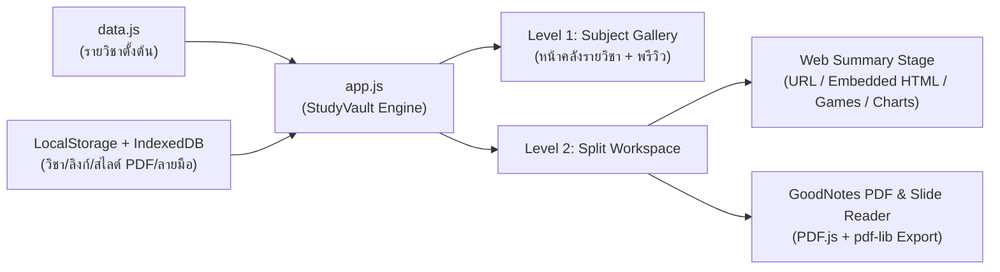

<div align="center">


# StudyVault (Study Hub Year 2) — คลังบทเรียนและสไลด์อ่านเทียบข้างๆ

**ศูนย์รวมเว็บสรุปบทเรียนและสไลด์เรียนแบบ Side-by-Side พร้อมระบบจดโน้ตบน PDF สไตล์ GoodNotes**  
*ดีไซน์สว่างสดใส สบายตา (Airy Daylight Porcelain &amp; Luminous Midnight Cobalt)*

[](https://phumshoprt.github.io/STUDY_WEB/)
[](https://mozilla.github.io/pdf.js/)
[](#-สถาปัตยกรรมระบบ)

[**🚀 เปิดใช้งานเว็บจริง (GitHub Pages)**](https://phumshoprt.github.io/STUDY_WEB/) · [**📖 วิธีใช้งาน**](#-วิธีใช้งานอย่างรวดเร็ว)

</div>

---

## ✨ ฟีเจอร์หลัก (Core Features)

### 1. 📚 สร้างและจัดการรายวิชาได้ง่าย (รหัสวิชา + ชื่อวิชา + ลบวิชาชัดเจน)
- กด **`+ เพิ่ม / ลบวิชา`** เพื่อสร้างรายวิชาใหม่ทันทีด้วย **รหัสวิชา** และ **ชื่อวิชา** (ไม่ต้องกรอกโค้ดหรือลิงก์ล่วงหน้า)
- กดลบวิชาได้ทันทีทั้งจากหน้าการ์ด, หน้ารายละเอียดวิชา (`🗑️ ลบวิชา`), หรือในรายการจัดการวิชา พร้อม **Undo Bar 6 วินาที** กันเผลอลบพลาด

### 2. 🔒 อัปโหลดลิงก์และสไลด์เข้าวิชา (ระบบล็อควิชา + วางโค้ด HTML)
- กด **`เพิ่มลิงก์/สไลด์`** แล้วเลือกวิชาพร้อมกด **`🔒 ล็อควิชานี้ไว้`** เพื่ออัปโหลดลิงก์หรือสไลด์หลายชุดเข้าวิชาเดิมต่อเนื่องได้ทันที
- รองรับทั้ง **ลิงก์ URL** และ **อัปโหลด/วางโค้ด HTML** (รองรับเกมทบทวน, Flashcards, กราฟ Chart.js, และแบบจำลอง Interactive) เพื่อแสดงผลเต็มจอในกรอบทันที

### 3. ◫ โหมดอ่านเว็บสรุปเทียบสไลด์ข้างๆ กัน (Side-by-Side Split View)
- แบ่งหน้าจอ 2 ฝั่ง (เว็บสรุป ↔ สไลด์เรียน) พร้อม **เส้นแบ่งตรงกลางที่ลากปรับสัดส่วนซ้าย–ขวาได้ (25%–75%)** และปุ่ม **`⇄ สลับฝั่ง`**
- รองรับสไลด์ 3 รูปแบบ: **ไฟล์ PDF**, **ชุดรูปภาพสไลด์หลายแผ่น**, และ **ลิงก์ Google Slides / Canva**

### 4. ✏️ จดโน้ตบน PDF สไตล์ GoodNotes + ส่งออกไฟล์พร้อมลายมือ
- **เครื่องมือครบชุด:** ปากกาเส้นโค้งสมูท (`Quadratic Bezier`), ปากกาไฮไลท์โปร่งแสง (`34%`), ยางลบเส้น (`Stroke Eraser`), เลือกสีอิสระ, และปรับขนาดเส้น `1px–36px`
- **บันทึกถาวรในเครื่อง (IndexedDB):** เก็บพิกัดลายเส้นแบบ Normalized (`0..1`) ทำให้ซูมเข้า/ออก หรือปรับความกว้างจอ เส้นก็ยังตรงตำแหน่งเดิมเป๊ะ
- **Undo / Redo (`Ctrl+Z` / `Ctrl+Y`)** และปุ่มดาวน์โหลดทั้ง **ไฟล์ PDF ต้นฉบับ** และ **ไฟล์ PDF พร้อมลายมือที่เขียนไว้ (`-annotated.pdf`)** ด้วย `pdf-lib`

---

## 🏗️ สถาปัตยกรรมระบบ



---

## 📂 โครงสร้างโปรเจกต์

```text
STUDY_WEB/
├── index.html            # หน้าหลัก (Daylight Porcelain & Midnight Navy UI + GoodNotes Toolbar)
├── app.js                # ตรรกะหลัก (Subject CRUD, Subject Lock, Split Resizer, PDF Studio)
├── data.js               # ข้อมูลรายวิชาเริ่มต้น (RADP301 วิชารังสีพยาธิ)
├── db.js                 # IndexedDB Wrapper สำหรับเก็บ PDF, รูปสไลด์, HTML และลายมือโน้ต
├── site.webmanifest      # Web App Manifest (Chrome PWA & Home Screen App Info)
├── apple-touch-icon.png  # ไอคอน Safari Add to Home Screen (iPhone/iPad 180x180)
├── favicon.ico           # Favicon มาตรฐานสำหรับเบราว์เซอร์ (16/32/48/64)
├── icons/                # ชุดโลโก้เว็บไซต์และไอคอน PWA (PNG 16x16 – 512x512)
├── start.bat             # ตัวเปิดเว็บจำลองในเครื่อง Windows (localhost:3000) แบบคลิกเดียว
├── .nojekyll             # ปิดการกรองไฟล์ของ Jekyll บน GitHub Pages
└── README.md             # คู่มือการใช้งาน
```

---

## 🚀 วิธีใช้งานอย่างรวดเร็ว

- **ออนไลน์ผ่าน GitHub Pages:** 👉 **https://phumshoprt.github.io/STUDY_WEB/**
- **รันบนเครื่องตัวเอง:** ดับเบิ้ลคลิก `start.bat` หรือรัน `python -m http.server 3000` แล้วเปิด `http://localhost:3000`

<div align="center">
  <sub>Built for studying · Powered by PDF.js &amp; pdf-lib</sub>
</div>
